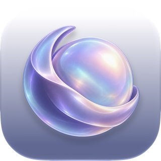

  
  <h1>OPAL</h1>
  
<strong>Every version, in its place.</strong>

  
A listening room for the songs, mixes, and ideas behind a record.

  
<strong><a href="https://github.com/SaifMalik0162/OPAL/releases">Download OPAL</a></strong>

  
Early alpha &nbsp;·&nbsp; macOS (Apple silicon and Intel) &nbsp;·&nbsp; Windows x64

---

## From first take to final sequence

- **Keep every mix with its song.** Organize tracks by project and switch between alternate versions as you listen.
- **Leave a note right where you hear it.** Mark a moment on the waveform so you can find it again.
- **Hear the record in order.** Arrange tracks in the Sequence Room, then save a selection of versions as a Listening Capsule to revisit later.

## Try the alpha

OPAL keeps your audio, artwork, and notes on your device. Listening Capsules stay in your library too. Start with a few tracks you already have backed up.

If something feels off, [tell us what happened](https://github.com/SaifMalik0162/OPAL/issues/new/choose). Include your OPAL version and operating system, and keep personal files out of public reports.

[License](LICENSE) · [Report a security issue privately](SECURITY.md)
